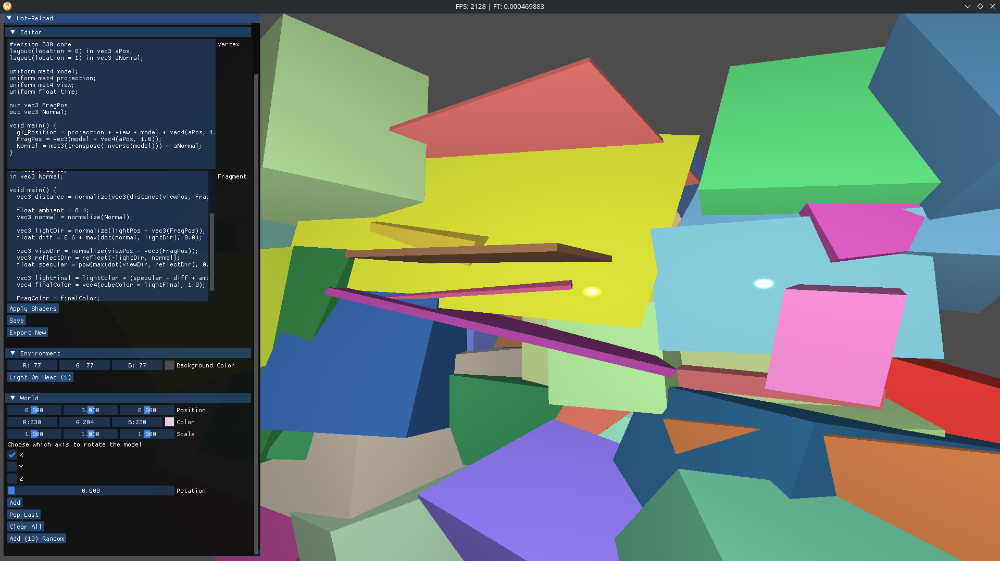

# Shader Editor 3D
A simple shader editor with 3D objects. You can add some cubes, change its scale, rotation, size and color, or for faster tests, just click on a button to add 10 random cubes. Without textures yet. I made this to improve my skills of develop systems and practice shaders. You also can do the main goal: edit, save and export shaders.

## Technologies
* GLFW
* Dear ImGui
* GLAD
* portable-file-dialog
* stb_image
* GLM
* OpenGL
* C++23

## Build
```bash
mkdir build && cmake -S . && cmake -B build && cmake --build build && ./build/ShaderEditor3D
```
